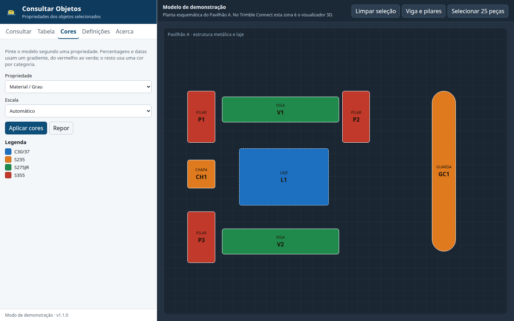
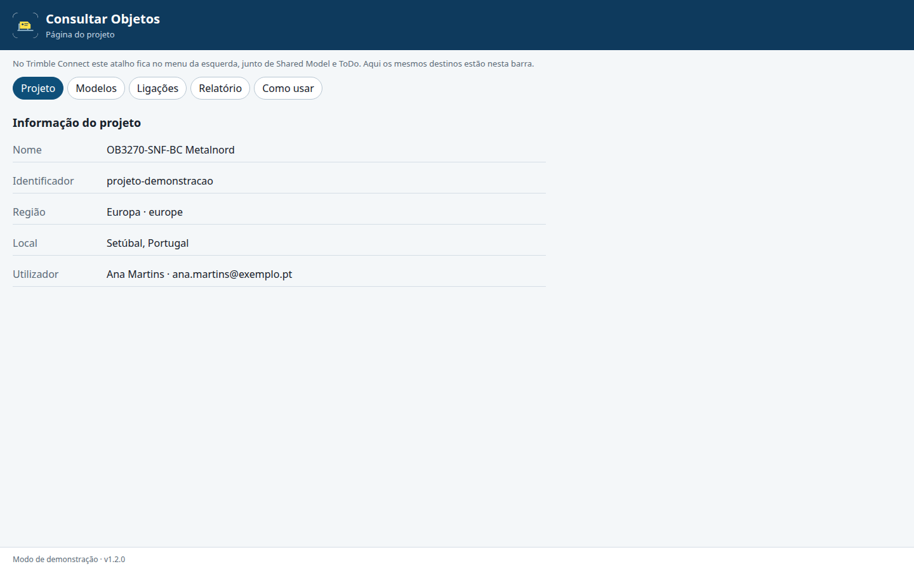
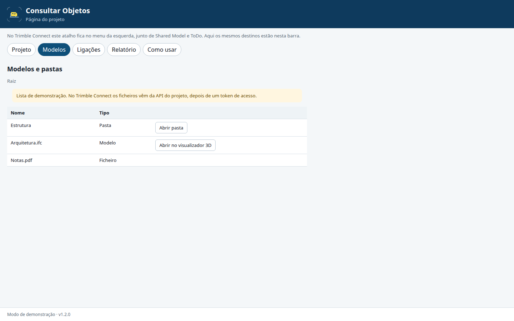
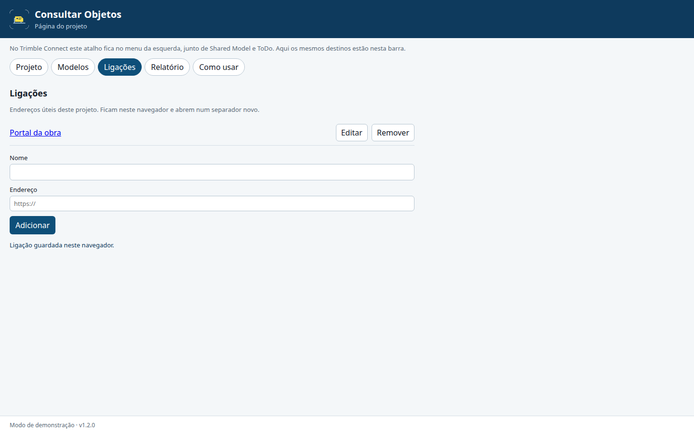
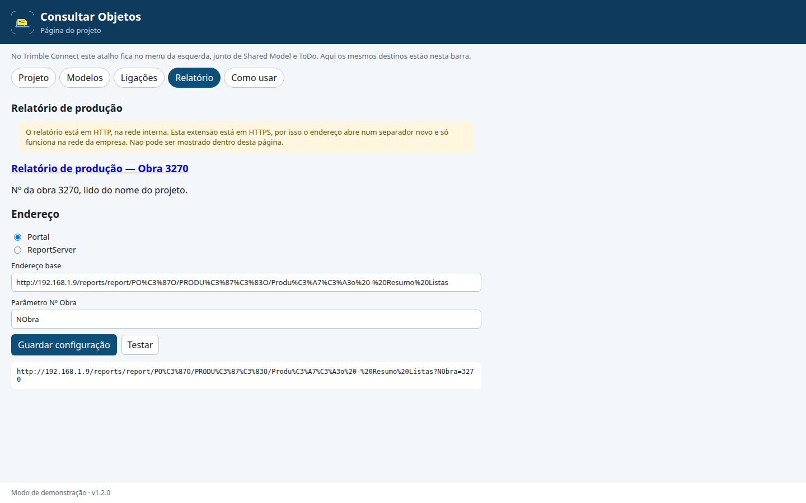
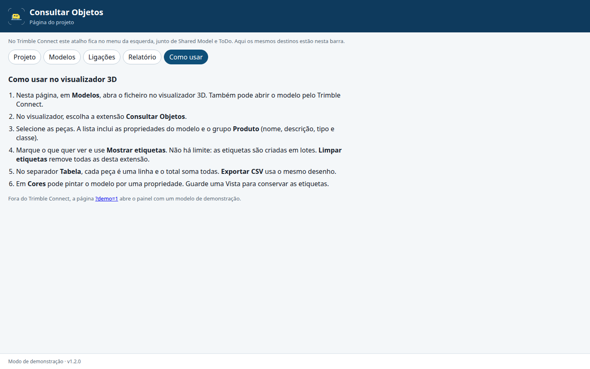

# Consultar Objetos

Extensão para o visualizador 3D do Trimble Connect. Mostra as propriedades dos objetos selecionados, coloca etiquetas no modelo e exporta uma tabela para o Excel. Serve para consultar peças em obra e em aprovisionamento, no computador.

Funciona dentro do Trimble Connect, no menu do projeto e no visualizador 3D, e fora dele num modo de demonstração.

Manifesto: <https://eduardopoco.github.io/tc-consultar-objetos/manifest.json>

O manifesto declara `extensionType: ["project", "3dviewer"]`. No projeto, a extensão regista-se no menu da esquerda (`ui.setMenu`), com o ícone e os atalhos Projeto, Modelos, Ligações, Relatório e Como usar. No visualizador 3D o painel de consulta mantém-se.

A mesma página decide o contexto ao arrancar. `ui.setMenu` corre logo depois de `connect`, antes de qualquer token ou leitura de ficheiros, com título, comando, ícone PNG e submenus. O evento `extension.command` traz o comando em `data`. Se `extension.getHost` disser `3dviewer`, abre o painel 3D. A página do projeto abre quando o anfitrião diz `project` e o painel do visualizador (`ui.getUI`) não está presente. Se a deteção falhar, fica o painel 3D. O separador **Acerca** mostra o contexto detetado, a versão da API e os erros de menu.

Se o menu da esquerda continuar vazio, há um segundo manifesto só de projeto: <https://eduardopoco.github.io/tc-consultar-objetos/manifest-projeto.json>.

## Como usar

Abra o modelo no visualizador 3D e escolha **Consultar Objetos** nas extensões. Fora do Trimble Connect, abra a página da extensão: o painel é o mesmo e a planta da direita substitui o visualizador.

### 1. Painel sem seleção

Por omissão a lista usa as propriedades encontradas nos objetos. Em Definições pode escolher um conjunto de colunas da Tabela de dados; essa escolha fica gravada. Enquanto não houver seleção, os botões de etiquetas e de isolamento ficam inativos.


### 2. Seleção e propriedades

No modo de demonstração, clique na planta; Ctrl+clique adiciona à seleção. Com um único objeto, o valor de cada propriedade aparece à direita. O grupo **Produto** (nome, descrição, tipo e classe) fica no topo: são os atributos que o Trimble Connect mostra fora dos conjuntos de propriedades. Um nome repetido noutro grupo continua a ser outra linha.


A tabela, o total e as etiquetas incluem todos os objetos selecionados. Não há limite. Numa seleção grande, as propriedades e as etiquetas são pedidas ao visualizador em lotes, com progresso e um botão para cancelar, para o modelo não bloquear.

### 3. Escolher o que mostrar

Marque as propriedades que quer ver nas etiquetas e na tabela. **A–Z** / **Z–A** muda a ordem. **Marcar todas** e **Desmarcar** atuam sobre a lista visível.


A lista vem do conjunto de colunas da Tabela de dados (`dataTable.getColumnSets`). Se a Tabela de dados não estiver disponível, a lista é construída a partir das propriedades encontradas nos objetos. Em **Definições** pode trocar o conjunto ou escolher **Propriedades encontradas**, e carregar de novo com **Atualizar**.

### 4. Etiquetas no modelo

**Mostrar etiquetas** coloca, junto de cada objeto selecionado, só os valores das propriedades marcadas. Vários valores ficam na mesma linha, com o separador escolhido, ou um por linha. Em **Definições** pode incluir o nome da propriedade e o nome do objeto; as duas opções começam desligadas. A cor, as unidades (mm, m², m³, kg, °) e a posição da etiqueta também se ajustam aí. As marcações são criadas em lotes. Enquanto isso, o painel mostra o progresso e **Cancelar** interrompe a colocação.


**Limpar etiquetas** remove todas as etiquetas criadas por esta extensão, mesmo que a colocação tenha sido cancelada a meio. As outras marcações do visualizador mantêm-se.

Dica: as etiquetas são marcações do visualizador. Guarde uma **Vista** (menu Views) para as conservar.

### 5. Tabela e CSV

O separador **Tabela** põe cada peça numa linha e cada propriedade marcada numa coluna. A primeira coluna identifica a peça (nome e, se existir, a marca de conjunto). A última linha soma pesos, áreas e comprimentos de todos os objetos selecionados, com a unidade; nas colunas de texto mostra o número de peças. A pesquisa filtra as colunas. Um clique no cabeçalho ordena. Não há limite de objetos na tabela: as propriedades são lidas em lotes, com progresso e um botão para cancelar. **Exportar CSV** segue esta disposição, com a linha de total, separador `;` e BOM UTF-8.


### 6. Isolar e colorir

**Isolar e colorir** deixa visíveis só os objetos da consulta e pinta-os com a cor de realce. **Repor** devolve a visibilidade e as cores do modelo, sem apagar as etiquetas.


### 7. Cores

No separador **Cores**, escolha uma propriedade do modelo, por exemplo o grau do material. As percentagens e as datas recebem um gradiente, do vermelho ao verde; os textos recebem uma cor por categoria. A legenda fica no painel. **Repor** devolve as cores do modelo.



## Página do projeto

Abra `?projeto=1` para ver a página sem um projeto Trimble Connect. O projeto de demonstração chama-se `OB3270-SNF-BC Metalnord`.

### Informação

Nome, identificador, região e utilizador atual (`project.getProject` e `user.getUser`).



### Modelos e pastas

A lista pede um token com `extension.requestPermission("accesstoken")` e lê a API do Trimble Connect da região do projeto (Europa, América do Norte ou Ásia). **Abrir no visualizador 3D** usa `extension.goTo("3dviewer")`.

Se o token não chegar, a página explica que é preciso uma aplicação na Trimble Developer Console, com o endereço `https://eduardopoco.github.io/tc-consultar-objetos/` autorizado a ler os ficheiros do projeto. O resto da página não fica bloqueado. No modo de demonstração a lista é fictícia.



### Ligações

Nome e endereço, guardados neste navegador por projeto. Abrem num separador novo. Dá para adicionar, editar e remover.



### Relatório de produção

O número da obra são os quatro dígitos a seguir a `OB` no nome do projeto (`OB3270-SNF-BC Metalnord` → 3270, também `ob3228 …`). Se o nome não começar assim, há um campo para o escrever; fica guardado nesse projeto.

O atalho chama-se **Relatório de produção — Obra 3270** e abre noutro separador. O endereço base, o tipo (portal ou ReportServer) e o parâmetro são editáveis. O valor inicial do parâmetro é `NObra`, o nome interno de Nº Obra. **Testar** mostra o endereço gerado sem sair da página.

O relatório está em HTTP na rede interna (`192.168.1.9`). A extensão está em HTTPS no GitHub Pages. O browser não deixa meter essa página dentro da extensão (conteúdo misto), por isso o atalho tem de abrir num separador novo e só funciona na rede da empresa.



### Como usar o visualizador

A página resume os passos do painel 3D: abrir o modelo, escolher a extensão, etiquetas, tabela, CSV e cores.



## Instalar no Trimble Connect

É preciso um **plano pago** do Trimble Connect e ser **administrador do projeto**. Numa conta gratuita, a opção de extensões personalizadas não aparece.

1. Abra o projeto no Trimble Connect for Browser.
2. No painel esquerdo, abra **Settings** (definições do projeto).
3. Abra **Apps & Capabilities**.
4. Escolha **+ Add Custom**.
5. No campo **Capability Manifest URL**, cole:

   `https://eduardopoco.github.io/tc-consultar-objetos/manifest.json`

6. Confirme com **Add**.
7. Abra um modelo no visualizador 3D.
8. Abra a extensão **Consultar Objetos** no painel de extensões do visualizador. No projeto, o mesmo nome aparece no menu da esquerda.

Se a extensão já estava instalada só como visualizador 3D, retire-a em **Apps & Capabilities** e volte a adicioná-la com o mesmo manifesto. O Trimble Connect guarda o tipo da extensão no momento em que ela é adicionada; um simples recarregar pode não criar a entrada do menu do projeto. Depois, recarregue o separador sem cache (o Pages guarda a página durante 10 minutos).

O manifesto declara `extensionType: ["3dviewer"]`, por isso a extensão entra no visualizador 3D e não na interface geral do projeto. O ícone e o endereço da aplicação vêm do mesmo sítio:

- aplicação: <https://eduardopoco.github.io/tc-consultar-objetos/>
- ícone: <https://eduardopoco.github.io/tc-consultar-objetos/icon.svg>

O Trimble Connect transfere o manifesto a partir do browser, por isso o endereço tem de responder com CORS. O GitHub Pages envia `Access-Control-Allow-Origin: *`.

Para a lista seguir os seus presets, crie primeiro um conjunto de colunas na **Tabela de dados** do visualizador e escolha-o em **Definições**.

## O que só se confirma dentro do Trimble Connect

O modo de demonstração cobre o painel, a seleção, as etiquetas, a tabela, o CSV, o isolamento e as cores. Estes pontos dependem do visualizador real e não ficam provados pelos testes automáticos:

- o carregamento do manifesto em **Apps & Capabilities** (plano, permissões e CORS visto pelo domínio do Trimble Connect) e a entrada no menu do projeto (`ui.setMenu`);
- o token de acesso e a lista real de ficheiros (`extension.requestPermission("accesstoken")` e a API da região). Sem uma aplicação na Developer Console, a lista pode falhar e a página mostra o motivo;
- abrir um modelo com `extension.goTo("3dviewer")`;
- o relatório interno em HTTP, a partir de um computador na rede da empresa;
- o evento `viewer.onSelectionChanged` e `viewer.getObjectProperties` com um modelo IFC ou Tekla;
- os conjuntos de colunas reais da Tabela de dados (`API.dataTable`); se a API recusar, a extensão passa a usar as propriedades dos objetos;
- a posição das etiquetas (`markup.addTextMarkup`). As caixas delimitadoras vêm em metros, como a posição do objeto, e a marcação pede milímetros. Uma caixa maior que 300 na sua maior dimensão é tratada como se já estivesse em milímetros. A folga da etiqueta é de 600 mm em X e 400 mm em Z, a partir do canto superior da caixa. Convém confirmar num modelo conhecido se o texto fica mesmo ao lado da peça;
- `isolateEntities` e `setObjectState` (cor e `visible: "reset"` / `color: "reset"`). **Repor** não mexe na câmara;
- guardar uma Vista e voltar a abri-la com as etiquetas;
- o comportamento do iframe da extensão (armazenamento local no domínio `github.io`).

## Desenvolvimento

Requisitos: Node.js 22.

```bash
npm install
npx playwright install chromium
npm run dev
```

Abra <http://127.0.0.1:5173/?demo=1> para o visualizador e <http://127.0.0.1:5173/?projeto=1> para a página do projeto. `?projeto=1&nome=Armazem` simula um projeto sem número de obra. `?semTabela=1` simula a Tabela de dados indisponível. Dentro de um iframe, a página liga-se ao Trimble Connect e escolhe o painel 3D ou a página do projeto conforme `extension.getHost()`.

Os separadores **Conjuntos** e **Fabrico** estão desligados em `src/features.ts` (`FEATURES.conjuntos` e `FEATURES.fabrico`). O código permanece; para os voltar a mostrar basta pôr o respetivo valor a `true`. Com os dois desligados, a ordem dos separadores é Consultar, Tabela, Cores, Definições, Acerca.

```bash
npm test
npm run test:e2e
npm run build
```

`npm test` corre a formatação, o texto das etiquetas, a criação das marcações em lotes, o CSV, os atributos de produto, a leitura da seleção e o endereço do relatório. `npm run test:e2e` abre os modos de demonstração no Chromium. Para voltar a gerar as imagens de `docs/imagens/`:

```bash
npx playwright test tests/e2e/screenshots.spec.ts tests/e2e/projeto-screenshots.spec.ts
```

A publicação está em `.github/workflows/pages.yml`. Corre em cada push para `main` e para ramos `cursor/*`, e também com **workflow_dispatch**. O botão de execução manual no separador Actions só aparece quando o fluxo já está no ramo predefinido (`main`); até lá, um push para o ramo da extensão volta a lançar a publicação. O site é compilado com a base `/tc-consultar-objetos/`.

Nas definições do repositório, **Settings → Pages → Build and deployment → Source** tem de ser **GitHub Actions**. Sem isso o fluxo falha com «Get Pages site failed» e o manifesto ainda não existe. Quem ativar o Pages pode ter de permitir o ramo `cursor/consultar-objetos-b8f8` em **Settings → Environments → github-pages → Deployment branches**, para a publicação deste ramo funcionar antes do merge. Depois de ativar, use **Re-run** no fluxo falhado. O token usado para abrir este pedido de integração não tem permissão de administração do repositório, por isso não consegue ligar o Pages sozinho.

## Versão

1.2.1
