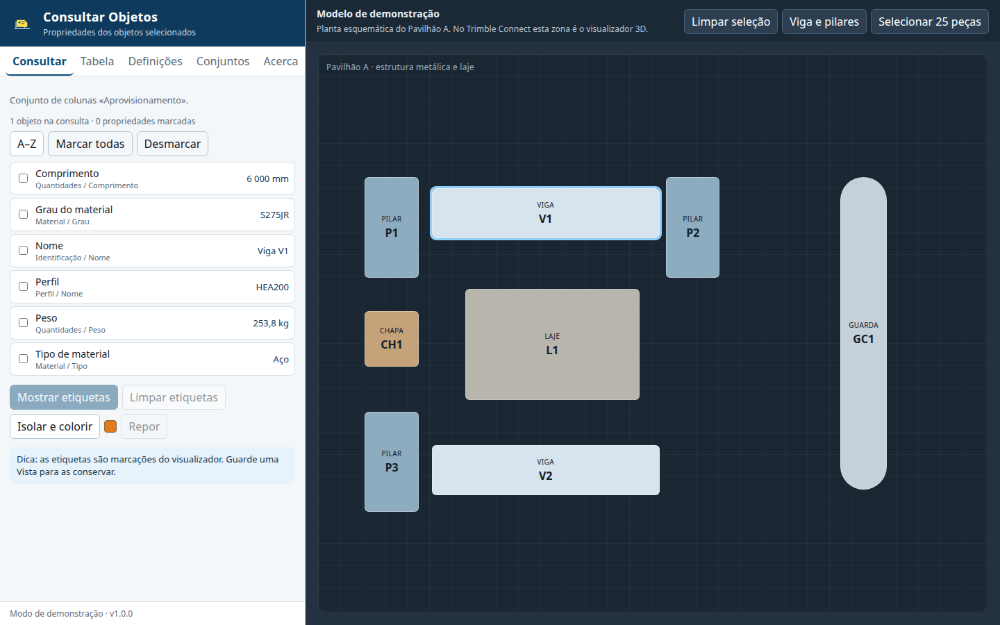
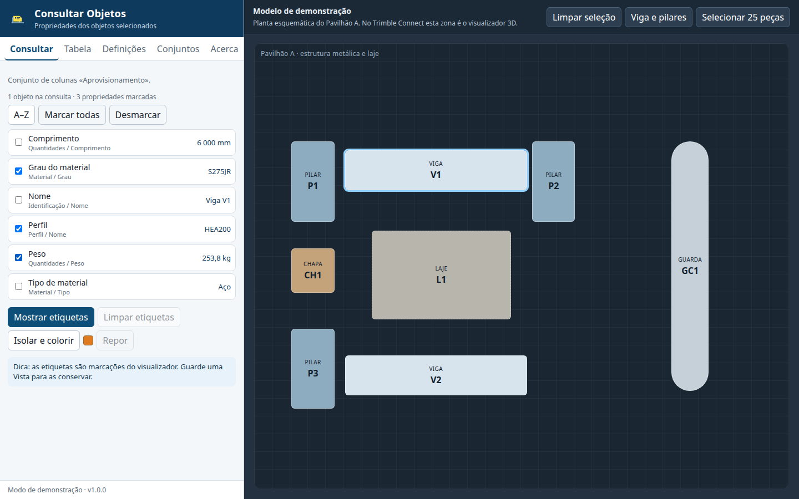
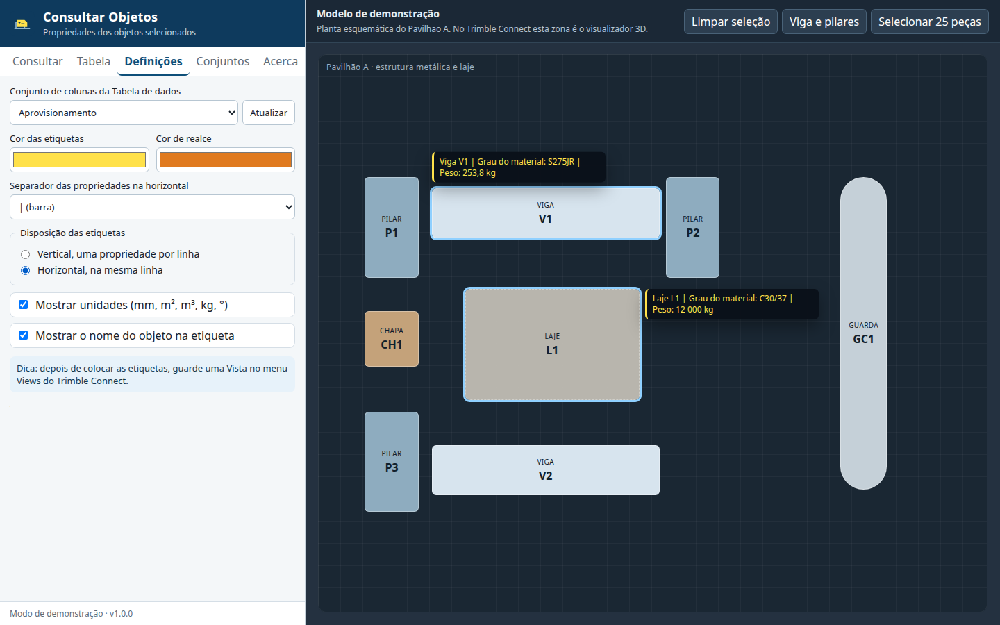
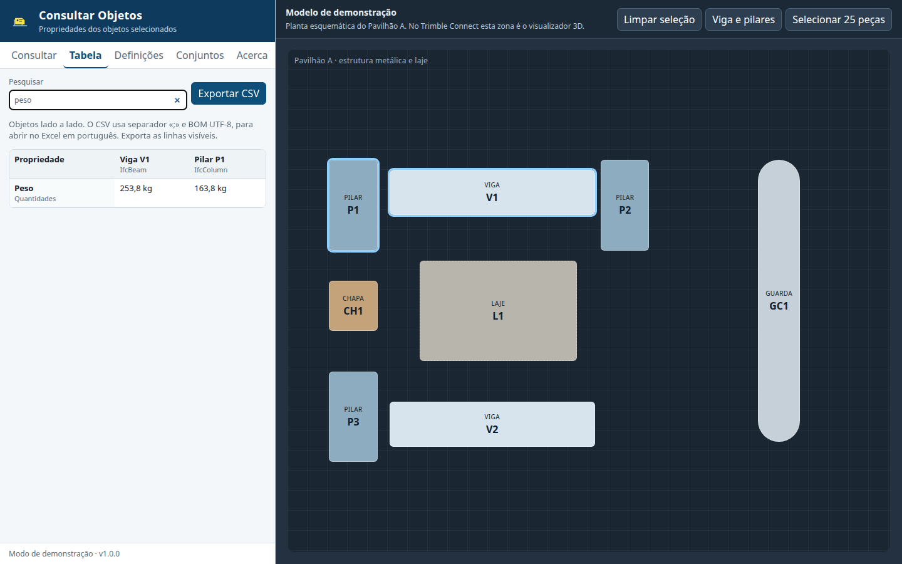
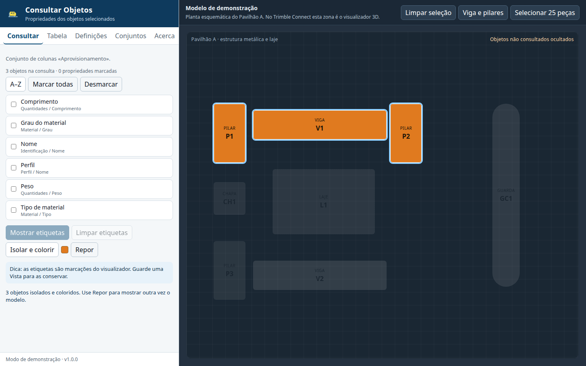

# Consultar Objetos

Extensão para o visualizador 3D do Trimble Connect. Mostra as propriedades dos objetos selecionados, coloca etiquetas no modelo e exporta uma tabela para o Excel. Serve para consultar peças em obra e em aprovisionamento, no computador.

Funciona dentro do Trimble Connect e, fora dele, num modo de demonstração com um modelo fictício (Pavilhão A), para se poder experimentar e testar sem projeto.

Manifesto: <https://eduardopoco.github.io/tc-consultar-objetos/manifest.json>

## Como usar

Abra o modelo no visualizador 3D e escolha **Consultar Objetos** nas extensões. Fora do Trimble Connect, abra a página da extensão: o painel é o mesmo e a planta da direita substitui o visualizador.

### 1. Painel sem seleção

O conjunto de colunas ativo da Tabela de dados aparece como lista. Enquanto não houver seleção, os botões de etiquetas e de isolamento ficam inativos.


### 2. Seleção e propriedades

Selecione até 20 objetos. No modo de demonstração, clique na planta; Ctrl+clique adiciona à seleção. Com um único objeto, o valor de cada propriedade aparece à direita.



Se selecionar mais de 20 objetos, a extensão avisa e consulta só os primeiros 20.

### 3. Escolher o que mostrar

Marque as propriedades que quer ver nas etiquetas e na tabela. **A–Z** / **Z–A** muda a ordem. **Marcar todas** e **Desmarcar** atuam sobre a lista visível.



A lista vem do conjunto de colunas da Tabela de dados (`dataTable.getColumnSets`). Se a Tabela de dados não estiver disponível, a lista é construída a partir das propriedades encontradas nos objetos. Em **Definições** pode trocar o conjunto ou escolher **Propriedades encontradas**, e carregar de novo com **Atualizar**.

### 4. Etiquetas no modelo

**Mostrar etiquetas** coloca um texto junto de cada objeto. A posição usa a caixa delimitadora do objeto. Pode escolher a cor, a disposição vertical ou horizontal, o separador, se as unidades aparecem (mm, m², m³, kg, °) e se o nome do objeto entra na etiqueta.



**Limpar etiquetas** remove só as etiquetas criadas por esta extensão.

Dica: as etiquetas são marcações do visualizador. Guarde uma **Vista** (menu Views) para as conservar.

### 5. Tabela e CSV

O separador **Tabela** põe os objetos lado a lado. A pesquisa filtra propriedades e valores, sem distinguir acentos. **Exportar CSV** grava as linhas visíveis num ficheiro com separador `;` e BOM UTF-8, para abrir no Excel em português. Os números vão com vírgula decimal, sem unidade, para se poderem somar.



### 6. Isolar e colorir

**Isolar e colorir** deixa visíveis só os objetos da consulta e pinta-os com a cor de realce. **Repor** devolve a visibilidade e as cores do modelo, sem apagar as etiquetas.



### 7. Conjuntos de propriedades

Em **Conjuntos**, guarde a lista marcada com um nome, por exemplo `Aço: perfil, material, peso`. **Aplicar** volta a marcar essas propriedades. **Eliminar** tira o conjunto deste navegador.

Os conjuntos ficam em `localStorage`, neste computador e neste endereço. Não são gravados no projeto do Trimble Connect.


## Instalar no Trimble Connect

É preciso um **plano pago** do Trimble Connect e ser **administrador do projeto**. Numa conta gratuita, a opção de extensões personalizadas não aparece.

1. Abra o projeto no Trimble Connect for Browser.
2. No painel esquerdo, abra **Settings** (definições do projeto).
3. Abra **Apps & Capabilities**.
4. Escolha **+ Add Custom**.
5. No campo **Capability Manifest URL**, cole:

   `https://eduardopoco.github.io/tc-consultar-objetos/manifest.json`

6. Confirme com **Add**.
7. Abra um modelo no visualizador 3D.
8. Abra a extensão **Consultar Objetos** no painel de extensões do visualizador.

O manifesto declara `extensionType: ["3dviewer"]`, por isso a extensão entra no visualizador 3D e não na interface geral do projeto. O ícone e o endereço da aplicação vêm do mesmo sítio:

- aplicação: <https://eduardopoco.github.io/tc-consultar-objetos/>
- ícone: <https://eduardopoco.github.io/tc-consultar-objetos/icon.svg>

O Trimble Connect transfere o manifesto a partir do browser, por isso o endereço tem de responder com CORS. O GitHub Pages envia `Access-Control-Allow-Origin: *`.

Para a lista seguir os seus presets, crie primeiro um conjunto de colunas na **Tabela de dados** do visualizador e escolha-o em **Definições**.

## O que só se confirma dentro do Trimble Connect

O modo de demonstração cobre o painel, a seleção, as etiquetas, a tabela, o CSV, o isolamento e os conjuntos. Estes pontos dependem do visualizador real e não ficam provados pelos testes automáticos:

- o carregamento do manifesto em **Apps & Capabilities** (plano, permissões e CORS visto pelo domínio do Trimble Connect);
- o evento `viewer.onSelectionChanged` e `viewer.getObjectProperties` com um modelo IFC ou Tekla;
- os conjuntos de colunas reais da Tabela de dados (`API.dataTable`); se a API recusar, a extensão passa a usar as propriedades dos objetos;
- a posição das etiquetas (`markup.addTextMarkup`). As caixas delimitadoras vêm em metros, como a posição do objeto, e a marcação pede milímetros. Uma caixa maior que 300 na sua maior dimensão é tratada como se já estivesse em milímetros. A folga da etiqueta é de 600 mm em X e 400 mm em Z, a partir do canto superior da caixa. Convém confirmar num modelo conhecido se o texto fica mesmo ao lado da peça;
- `isolateEntities` e `setObjectState` (cor e `visible: "reset"` / `color: "reset"`). **Repor** não mexe na câmara;
- guardar uma Vista e voltar a abri-la com as etiquetas;
- o comportamento do iframe da extensão (armazenamento local no domínio `github.io`).

## Desenvolvimento

Requisitos: Node.js 22.

```bash
npm install
npx playwright install chromium
npm run dev
```

Abra <http://127.0.0.1:5173/?demo=1>. `?semTabela=1` simula a Tabela de dados indisponível. Dentro de um iframe, a página tenta ligar-se ao Trimble Connect com `trimble-connect-workspace-api`; se a ligação falhar, o painel explica o erro e oferece o modo de demonstração.

```bash
npm test
npm run test:e2e
npm run build
```

`npm test` corre a formatação, o limite de 20 objetos, o texto das etiquetas, o CSV e os conjuntos. `npm run test:e2e` abre o modo de demonstração no Chromium e percorre o painel. Para voltar a gerar as imagens de `docs/imagens/`:

```bash
npx playwright test tests/e2e/screenshots.spec.ts
```

A publicação está em `.github/workflows/pages.yml`. Corre em cada push para `main` e para ramos `cursor/*`, e também com **workflow_dispatch** (este botão no separador Actions fica disponível quando o fluxo está no ramo predefinido). O site é compilado com a base `/tc-consultar-objetos/` e publicado pelo GitHub Pages a partir do Actions. Nas definições do repositório, a origem do Pages tem de ser **GitHub Actions**.

## Versão

1.0.0
